# Модель данных (ER-диаграмма)

Этап 5. Источник требований — [`docs/product/data-requirements.md`](../product/data-requirements.md).
Миграции — `database/migrations/2026_11_04_*` и исправленная `0001_01_01_000000_create_users_table.php`.

Общие правила схемы:
- деньги — `unsignedBigInteger` в **тиынах** (1 ₸ = 100 тиын);
- статусы — `string` + PHP backed enum (`app/Enums`) и каст в модели, без типов `ENUM`/`JSONB`/массивов;
- даты — `timestamp` в UTC, показ — `Asia/Almaty`;
- правила «одна активная запись/заявка» проверяются в сервисах под блокировкой (частичных индексов нет —
  схема одинаково работает на PostgreSQL и SQLite).

```mermaid
erDiagram
    users ||--o| shelter_user : "работает в"
    shelters ||--o{ shelter_user : "сотрудники (owner/staff)"
    shelters ||--o{ pets : ""
    pets ||--o{ pet_photos : ""
    users ||--o{ favorites : ""
    pets ||--o{ favorites : ""
    users ||--o{ adoption_applications : "подаёт"
    pets ||--o{ adoption_applications : ""
    shelters ||--o{ donation_campaigns : ""
    pets |o--o{ donation_campaigns : "сбор на питомца"
    donation_campaigns ||--o{ campaign_reports : ""
    campaign_reports ||--o{ report_attachments : ""
    shelters ||--o{ donations : ""
    donation_campaigns |o--o{ donations : "null = общий фонд"
    users |o--o{ donations : "null = гость"
    shelters ||--o{ walk_templates : ""
    walk_templates ||--o{ walk_template_pet : ""
    pets ||--o{ walk_template_pet : ""
    shelters ||--o{ walk_slots : ""
    walk_templates |o--o{ walk_slots : "создан шаблоном"
    walk_slots ||--o{ walk_slot_pet : ""
    pets ||--o{ walk_slot_pet : ""
    walk_slots ||--o{ walk_bookings : ""
    users ||--o{ walk_bookings : ""
    pets |o--o{ walk_bookings : "выбранный питомец"

    users {
        bigint id PK
        string login UK "3–32, [a-z0-9_.-]"
        string name
        string phone UK "+77XXXXXXXXX"
        string email UK
        string role "Role: volunteer | shelter_staff | admin"
        string avatar_path
        bool is_blocked
        smallint birth_year
    }
    shelters {
        bigint id PK
        string name
        string slug UK
        text description
        string city
        string address
        string phone
        string email
        string website
        string bin_iin "12 цифр"
        string logo_path
        text walk_rules
        string status "ShelterStatus"
        text moderation_comment
        timestamp approved_at
    }
    shelter_user {
        bigint shelter_id FK
        bigint user_id FK,UK "один приют на пользователя"
        string role "ShelterMemberRole: owner | staff"
    }
    pets {
        bigint id PK
        bigint shelter_id FK
        string name
        string slug UK "barsik-7f3a"
        string species "Species"
        string sex "Sex"
        date birth_date
        bool birth_date_is_approx
        string size "PetSize"
        string breed
        string color
        text character
        bool good_with_kids "+ good_with_cats, good_with_dogs, house_trained, leash_trained"
        bool vaccinated "+ sterilized, chipped"
        text health_notes
        text story
        string status "PetStatus"
        bool can_walk
        bool guardianship_available
        date arrived_at
        timestamp adopted_at
        bool is_hidden
    }
    pet_photos {
        bigint id PK
        bigint pet_id FK
        string path
        smallint sort
        bool is_cover
    }
    favorites {
        bigint user_id FK "UK (user_id, pet_id)"
        bigint pet_id FK
    }
    adoption_applications {
        bigint id PK
        bigint pet_id FK
        bigint user_id FK
        string type "ApplicationType"
        string contact_name
        string contact_phone
        string city
        text experience
        text living_conditions
        text message
        string status "ApplicationStatus"
        text shelter_comment
        timestamp processed_at
    }
    donation_campaigns {
        bigint id PK
        bigint shelter_id FK
        bigint pet_id FK "nullable"
        string title
        string slug UK
        string short_description
        text description
        bigint goal_amount "тиын"
        bigint raised_amount "тиын, денормализация"
        int donations_count "денормализация"
        timestamp starts_at
        timestamp ends_at
        bool allow_overfunding
        string cover_path
        string status "CampaignStatus"
        bool is_hidden
        timestamp completed_at
    }
    campaign_reports {
        bigint id PK
        bigint campaign_id FK
        string title
        text body
        bigint spent_amount "тиын"
        timestamp published_at
    }
    report_attachments {
        bigint id PK
        bigint campaign_report_id FK
        string path
        string type "AttachmentType: photo | receipt"
        smallint sort
    }
    donations {
        bigint id PK
        uuid uuid UK
        bigint campaign_id FK "nullable"
        bigint shelter_id FK
        bigint user_id FK "nullable"
        string donor_name
        string donor_email
        bool is_anonymous
        bigint amount "тиын"
        string comment
        string status "PaymentStatus"
        string provider "fake"
        string provider_payment_id "UK (provider, provider_payment_id)"
        uuid idempotency_key UK
        timestamp paid_at
    }
    walk_templates {
        bigint id PK
        bigint shelter_id FK
        tinyint weekdays "битовая маска Пн=1 … Вс=64"
        time start_time "Asia/Almaty"
        smallint duration_minutes
        smallint capacity
        string meeting_point
        date valid_from
        date valid_until
    }
    walk_template_pet {
        bigint walk_template_id FK "UK (template, pet)"
        bigint pet_id FK
    }
    walk_slots {
        bigint id PK
        bigint shelter_id FK
        bigint template_id FK "nullable"
        timestamp starts_at "UTC"
        timestamp ends_at
        smallint capacity
        smallint booked_count "pending + confirmed"
        string meeting_point
        string status "WalkSlotStatus: open | cancelled"
    }
    walk_slot_pet {
        bigint walk_slot_id FK "UK (slot, pet)"
        bigint pet_id FK
    }
    walk_bookings {
        bigint id PK
        bigint walk_slot_id FK
        bigint user_id FK
        bigint pet_id FK "nullable"
        string status "BookingStatus"
        string comment
        string shelter_comment
        string cancelled_by "CancelledBy"
        timestamp confirmed_at
        timestamp cancelled_at
    }
```

## Удаление и внешние ключи

| Связь | При удалении родителя | Почему |
|-------|----------------------|--------|
| `donations.shelter_id`, `donations.campaign_id` | **запрет** (`restrict`) | история пожертвований неприкосновенна: приют/сбор с пожертвованиями не удаляется, а архивируется статусом |
| `donations.user_id` | `null` | пожертвование остаётся, становится «гостевым» |
| `donation_campaigns.pet_id`, `walk_bookings.pet_id`, `walk_slots.template_id` | `null` | сбор/запись/слот живут без питомца/шаблона |
| остальные (`pets`, `pet_photos`, `favorites`, `shelter_user`, заявки, слоты, записи, отчёты) | каскад | дочерние записи без родителя не имеют смысла |

«Удаление» публичного контента в интерфейсе — статус `archived` (питомцы, сборы), а не `DELETE`.

## Индексы

- `pets`: `(status, is_hidden)`, `(shelter_id, status)`, `species`, `arrived_at` — каталог и фильтры;
- `donation_campaigns`: `(status, is_hidden)`, `(shelter_id, status)`;
- `donations`: `(campaign_id, status)`, `(shelter_id, status)`, `(user_id, status)` — пересчёт сумм, кабинеты;
- `walk_slots`: `(shelter_id, starts_at)`, `(status, starts_at)` — расписание;
- `walk_bookings`: `(walk_slot_id, status)`, `(user_id, status)`, `(pet_id, status)` — правила W4–W6;
- `adoption_applications`: `(pet_id, status)`, `(user_id, status)`.

## Вычисляемые значения

| Что | Где |
|-----|-----|
| Состояние слота «свободен / мало мест / мест нет / прошёл / отменён» | `WalkSlot::state()` → `WalkSlotState` |
| Возраст в месяцах | `Pet::ageInMonths()` (склонение — хелпер этапа 7) |
| Прогресс сбора, 0–100 % | `DonationCampaign::progressPercent()` |
| `raised_amount`, `donations_count` | `DonationCampaign::recalculateTotals()` (только `succeeded`) |
| `booked_count` | `WalkSlot::recalculateBookedCount()` (`pending` + `confirmed`) |
