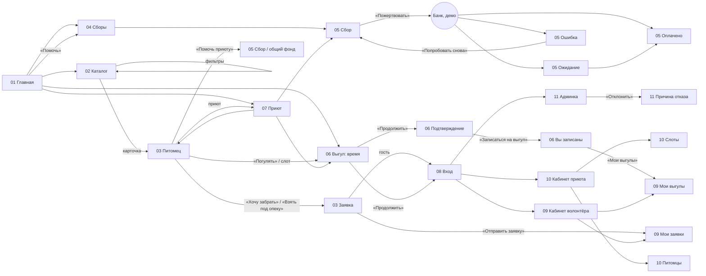

# Макеты ключевых экранов

Этап 3. Макеты собраны из компонентов UI-кита (`design/tools/components.js`) генератором
`design/tools/screens*.js`, поэтому размеры, цвета и тексты совпадают с токенами и UI-китом.

- Исходники: `design/screens/NN-slug.svg` — в каждом файле артборды слева направо
  (`<g id="artboard-NN-slug-<key>">`, текст — текстом, слои по блокам). Открываются в Illustrator / Figma / Inkscape.
- Превью: `design/screens/png/NN-slug-<key>.png` — desktop в 1×, mobile в 2× (780 px).
- Пересборка: `node design/tools/build.mjs` (всё) или `node design/tools/build.mjs --screens` (только PNG экранов).

## 1. Состав

| № | Экран | URL | Артборды (PNG) |
|---|-------|-----|----------------|
| 01 | Главная | `/` | `desktop`, `mobile` |
| 02 | Каталог питомцев | `/pets` | `desktop`, `mobile`, `mobile-filters` (лист фильтров), `empty` (ничего не найдено), `loading` (скелетоны) |
| 03 | Карточка питомца | `/pets/{slug}`, `/pets/{slug}/apply` | `desktop`, `mobile` (липкая панель CTA), `apply` (заявка «забрать / под опеку») |
| 04 | Сборы | `/campaigns` | `desktop` (с блоком «в общий фонд приюта»), `mobile` |
| 05 | Страница сбора и пожертвование | `/campaigns/{slug}`, `/donations/{uuid}` | `desktop`, `mobile`, `form-errors`, `paid`, `pending`, `failed` |
| 06 | Запись на выгул | `/walks`, `/walks/slots/{id}` | `desktop` (шаг 2 — неделя слотов), `mobile`, `confirm` (шаг 3), `success-mobile` |
| 07 | Страница приюта | `/shelters/{slug}` | `desktop`, `mobile` |
| 08 | Вход и регистрация | `/login`, `/register` | `login`, `register-errors`, `mobile` (ошибка входа) |
| 09 | Кабинет волонтёра | `/cabinet`, `/cabinet/walks` | `overview`, `walks`, `walks-empty`, `mobile` (с тостом «Запись отменена») |
| 10 | Кабинет приюта | `/shelter`, `/shelter/pets`, `/shelter/slots` | `dashboard`, `pets` (приют на модерации), `slots`, `mobile` |
| 11 | Админка | `/admin`, `/admin/shelters` | `shelters`, `reject-modal`, `stats`, `mobile` |
| 12 | Состояния и ошибки | 404, 500, общие | `404`, `500`, `empty-loading-success` (6 пустых экранов, скелетон, кнопка-спиннер, тосты, сводка ошибок формы) |

### Покрытие состояний

| Состояние | Где показано |
|-----------|--------------|
| Пустое | каталог без результатов (02-empty), «Мои выгулы» (09-walks-empty), набор из 6 пустых экранов кабинетов (12) |
| Загрузка | скелетоны каталога (02-loading, 12), спиннер в кнопке отправки (12), ожидание ответа банка (05-pending) |
| Ошибка | поля формы пожертвования и регистрации (05-form-errors, 08-register-errors), ошибка входа (08-mobile), отказ банка (05-failed), тост «Не удалось сохранить» (12), 404 и 500 (12) |
| Успех | оплачено (05-paid), «Вы записаны на выгул» (06-success-mobile), тосты «Заявка отправлена», «Анкета опубликована», «Запись отменена» (09, 12) |
| Модерация | баннер «Приют на проверке» и бейдж в меню (10-pets), очередь и отклонение с причиной (11) |

## 2. Сетка и общие решения

- **Desktop 1440:** поля 80, контейнер 1280 (токен `layout.container` уточнён с 1240 до 1280: ровно 4 карточки
  питомца по 296 px с промежутком 32). Каталог: фильтры 296 + 3 колонки карточек. Сборы: 3 карточки по 405.
  Страницы сбора и питомца: основная колонка 720–760 + правая 472–520.
- **Кабинеты:** боковое меню 256 px (активный пункт — фон `ink-100` и бирочная полоса слева),
  контент 976 px, данные — в таблицах (шапка `ink-50`, строки 68–80 px, действия справа).
- **Mobile 390:** поля 16. Шапка: логотип, «Помочь» (гость) или колокольчик (вошёл), бургер.
  Каталог — сетка 2 × N из компактных карточек; фильтры — нижний лист с кнопкой «Показать 37 питомцев».
  На карточке питомца, сбора и при выборе слота — липкая нижняя панель действий (на макете показана
  в конце страницы; в браузере прижата к низу экрана).
- **Герой главной** — портрет питомца с крупной адресной биркой «Бублик, 2 года, ищет дом»: фирменный мотив
  выведен в главный визуальный элемент. Цифры проекта — спокойная плашка ниже, не «герой с цифрами».
- **Шаги записи на выгул** пронумерованы, потому что это действительно последовательность
  (приют → время → подтверждение). На телефоне видна подпись только текущего шага.
- **Деньги жёлтые:** жёлтые кнопки — только «Помочь», «Помочь сбору», «Пожертвовать», «Помочь приюту».
- Тексты кнопок и тостов согласованы: «Записаться на выгул» → «Вы записаны на выгул»,
  «Отменить запись» → «Запись отменена», «Отправить заявку» → «Заявка отправлена».

## 3. Схема переходов (прототип)

Ошибки 404/500 (экран 12) доступны с любой страницы; «Смотреть питомцев» ведёт в каталог.

## 4. Что не нарисовано отдельно (собирается из тех же блоков)

Список приютов `/shelters` (сетка карточек приюта с главной), «Как помочь» `/help` (три пути + FAQ),
восстановление пароля (форма входа с одним полем), профиль, уведомления, заявки и пожертвования в кабинетах
(таблицы по образцу «Мои выгулы»), формы питомца и сбора в кабинете приюта (поля из UI-кита),
сотрудники приюта, анкеты/сборы/пользователи в админке (таблицы по образцу модерации приютов).
Если для какого-то из них понадобится отдельный макет — добавить функцию в `design/tools/screens*.js`.
