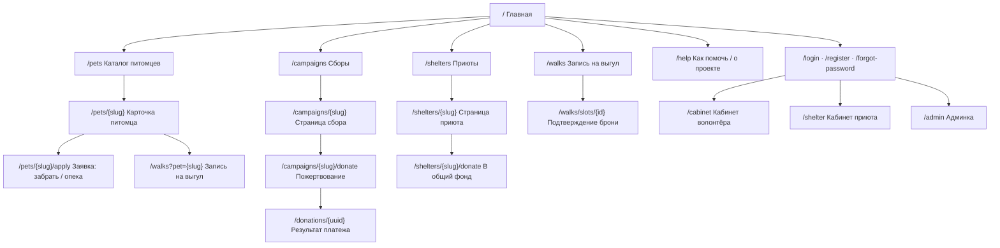

# Карта сайта (информационная архитектура)

## 1. Схема

## 2. Публичные страницы

| Страница | URL | Назначение | Ключевые блоки |
|----------|-----|-----------|----------------|
| Главная | `/` | вход в три пути помощи | герой; «как помочь» — 3 пути (забрать / пожертвовать / погулять); питомцы недели; активные сборы; ближайшие слоты выгула; приюты-партнёры; цифры проекта |
| Каталог питомцев | `/pets` | поиск питомца | фильтры: вид, пол, возраст, размер, приют, город, «готов к выгулу», «можно под опеку»; поиск по кличке; сортировка (новые / дольше всех ждут); пагинация |
| Карточка питомца | `/pets/{slug}` | решение «помочь этому питомцу» | галерея; кличка, возраст, пол, размер; характер; здоровье (прививки, стерилизация, чип); история; приют; CTA: «Хочу забрать», «Взять под опеку», «Записаться на выгул», «Помочь приюту» / сбор питомца; похожие питомцы |
| Заявка на питомца | `/pets/{slug}/apply` | заявка на усыновление/опеку | форма (тип заявки, контакты, опыт, условия), согласие на ПДн |
| Приюты | `/shelters` | список одобренных приютов | карточки: логотип, город, число питомцев, активные сборы |
| Страница приюта | `/shelters/{slug}` | всё о приюте | описание, адрес, контакты, правила выгула; питомцы; сборы; отчёты; ближайшие слоты; кнопка «Помочь приюту» |
| Сборы | `/campaigns` | список сборов | фильтр: активные / завершённые, приют, «на питомца»; карточки с прогрессом |
| Страница сбора | `/campaigns/{slug}` | убедить и принять пожертвование | цель, собрано, прогресс, срок; описание; питомец (если есть); последние пожертвования; отчёты о расходах; форма пожертвования |
| Пожертвование | `/campaigns/{slug}/donate`, `/shelters/{slug}/donate` | оплата | сумма-пресет / своя, имя, email, анонимно, комментарий, согласие → платёжная страница (демо) |
| Результат платежа | `/donations/{uuid}` | статус платежа | успех / ожидание / ошибка, «поделиться сбором» |
| Запись на выгул | `/walks` | выбрать слот | выбор приюта → питомец (опц.) → календарь (неделя) со слотами и свободными местами |
| Бронь слота | `/walks/slots/{id}` | подтверждение | детали слота, выбор питомца из доступных, комментарий, правила приюта → «Записаться» |
| Как помочь / о проекте | `/help` | объяснение сервиса | 3 пути помощи, FAQ, как стать приютом-партнёром |
| Вход / регистрация | `/login`, `/register`, `/forgot-password`, `/reset-password/{token}` | аутентификация | логин или телефон + пароль |
| Ошибки | 403, 404, 419, 429, 500 | фирменные страницы ошибок | — |
| Служебные | `/sitemap.xml`, `/privacy` | SEO, политика ПДн | — |

## 3. Кабинет волонтёра — `/cabinet`

| Раздел | URL | Содержимое |
|--------|-----|-----------|
| Обзор | `/cabinet` | ближайший выгул, статус заявок, избранное (превью) |
| Мои выгулы | `/cabinet/walks` | вкладки «Предстоящие» / «Прошедшие», отмена |
| Мои заявки | `/cabinet/applications` | заявки на усыновление/опеку и их статусы, отзыв |
| Мои пожертвования | `/cabinet/donations` | история, суммы, статусы |
| Избранное | `/cabinet/favorites` | карточки питомцев |
| Уведомления | `/notifications` | список, «прочитать все» |
| Профиль | `/cabinet/profile` | имя, телефон, email, пароль, аватар |
| Стать приютом | `/cabinet/shelter-request` | заявка на регистрацию приюта |

## 4. Кабинет приюта — `/shelter`

| Раздел | URL | Содержимое |
|--------|-----|-----------|
| Дашборд | `/shelter` | сводка: питомцы по статусам, активные сборы, записи на сегодня/неделю, новые заявки; баннер «на модерации» |
| Питомцы | `/shelter/pets`, `/create`, `/{pet}/edit` | таблица анкет, фильтр по статусу, CRUD, фото |
| Заявки | `/shelter/applications` | входящие заявки, смена статуса |
| Сборы | `/shelter/campaigns`, `/create`, `/{campaign}/edit` | CRUD сборов, закрытие |
| Отчёты | `/shelter/campaigns/{campaign}/reports` | отчёты о расходах |
| Пожертвования | `/shelter/donations` | список, фильтры, экспорт CSV |
| Слоты выгула | `/shelter/slots` | календарь недели, создание разового слота / шаблона на неделю |
| Записи на выгул | `/shelter/bookings` | список на дату, подтвердить / отклонить / состоялся / не пришёл |
| Профиль приюта | `/shelter/profile` | описание, адрес, контакты, логотип, правила выгула |
| Сотрудники | `/shelter/staff` | список, приглашение (только owner) |

## 5. Админка — `/admin`

| Раздел | URL | Содержимое |
|--------|-----|-----------|
| Статистика | `/admin` | метрики из брифа: пристройства, сумма сборов, выгулы, неявки |
| Приюты | `/admin/shelters` | очередь модерации, одобрить / отклонить с причиной / заблокировать |
| Контент | `/admin/pets`, `/admin/campaigns` | скрыть / вернуть анкету или сбор |
| Пользователи | `/admin/users` | поиск, блокировка, смена роли |

## 6. Навигация

- **Шапка (гость):** логотип · Питомцы · Сборы · Выгул · Приюты · Как помочь · [Войти] · [Помочь] (акцентная кнопка → пожертвование).
- **Шапка (авторизован):** то же + колокольчик уведомлений со счётчиком + меню аккаунта (кабинет по роли, профиль, выход).
- **Мобильная:** логотип, кнопка «Помочь», бургер → полноэкранное меню. Нижняя таб-панель не используется
  (меньше конфликтов с CTA на карточке питомца, где на мобильном — «липкая» панель действий).
- **Подвал:** разделы сайта, «Стать приютом-партнёром», политика ПДн, контакты проекта.
- **Хлебные крошки** — на карточке питомца, приюта, сбора и во всех кабинетах.
