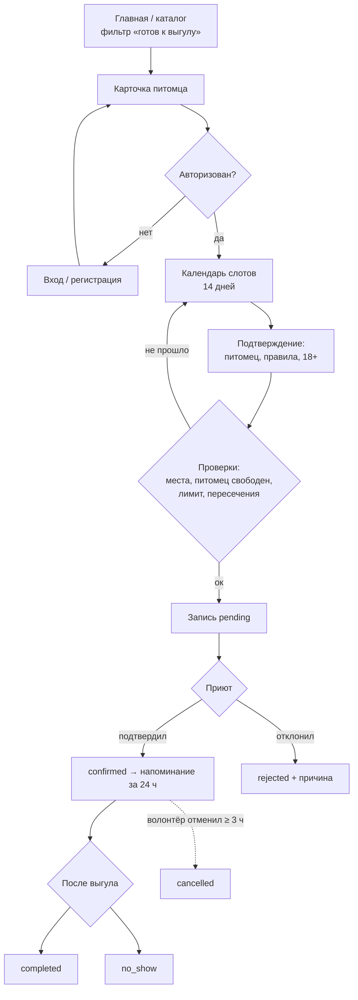
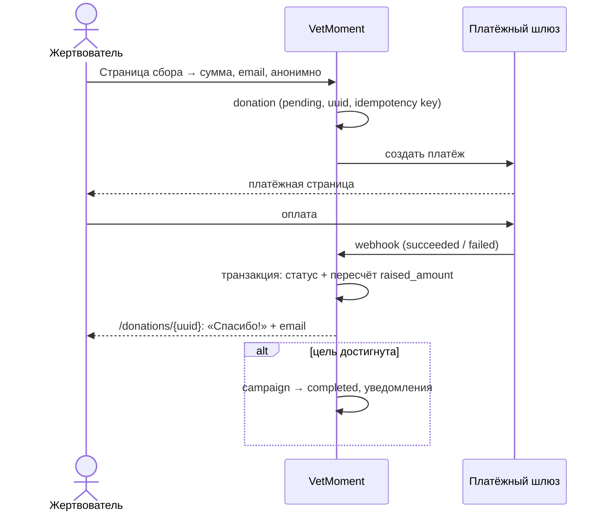
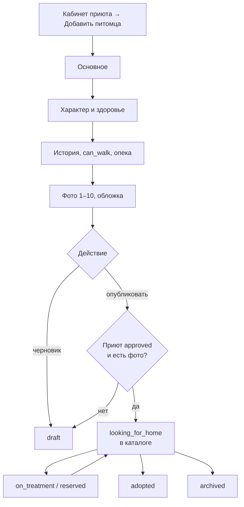
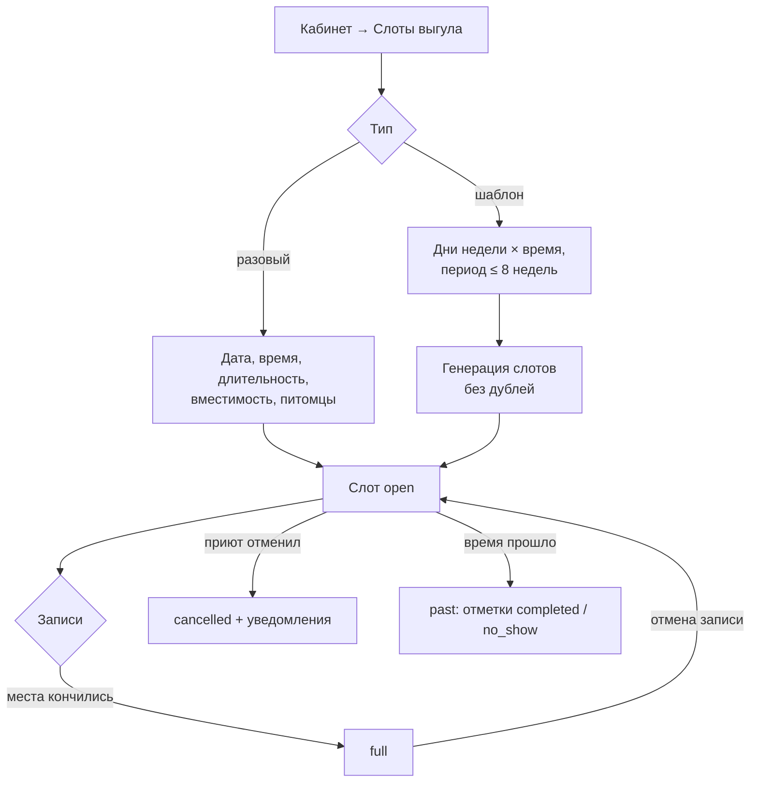
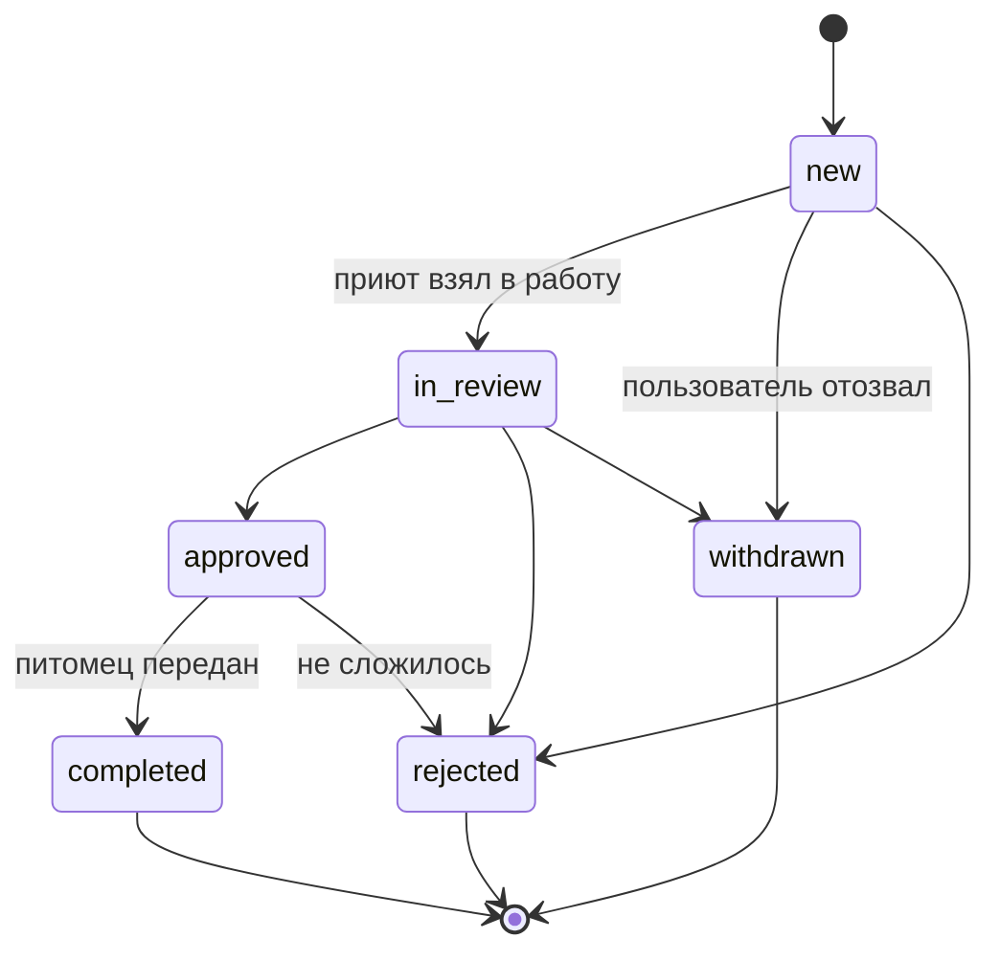
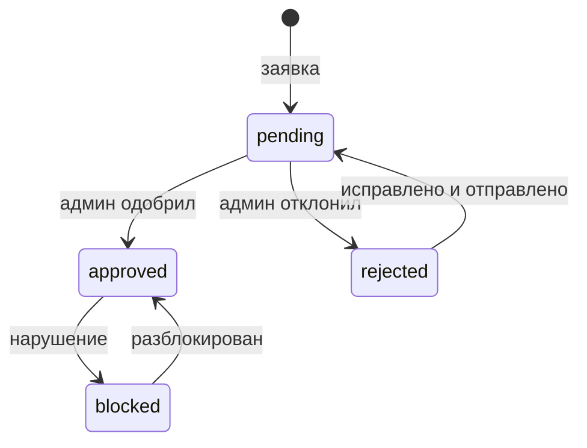

# User flows

Сценарии трёх ключевых функций + регистрация приюта. Для каждого — шаги, альтернативы/ошибки
и диаграмма. Статусы сущностей — в [`data-requirements.md`](data-requirements.md).

---

## 1. «Найти питомца → записаться на выгул» (волонтёр)

**Предусловия:** у приюта статус `approved`, у питомца `can_walk = true`, приют опубликовал слоты.

1. Пользователь открывает главную → «Погулять» или каталог `/pets` с фильтром «готов к выгулу».
2. Открывает карточку питомца → «Записаться на выгул».
3. Если не авторизован → вход/регистрация → возврат на ту же страницу (intended URL).
4. Видит календарь ближайших 14 дней со слотами приюта, где доступен этот питомец; у слота — время и
   «осталось мест N».
5. Выбирает слот → экран подтверждения: питомец (предвыбран, можно сменить на другого доступного),
   правила выгула приюта, комментарий, чекбокс «С правилами ознакомлен(а), мне есть 18 лет».
6. «Записаться» → запись в статусе `pending`, приюту — уведомление.
7. Приют подтверждает → `confirmed`, волонтёру — уведомление; за 24 ч — напоминание.
8. После выгула приют отмечает `completed` или `no_show`.

**Ошибки и альтернативы:**
- слот заполнился, пока пользователь думал → «Мест больше нет», показать соседние слоты;
- питомец уже забронирован на этот слот другим → предложить другого питомца или слот;
- достигнут лимит активных броней (3) → сообщение со ссылкой на «Мои выгулы»;
- у пользователя уже есть запись, пересекающаяся по времени → запрет;
- слот в прошлом или начинается менее чем через 2 ч → недоступен;
- отмена волонтёром не позднее чем за 3 ч до начала; позже — «свяжитесь с приютом» (телефон);
- приют отклонил запись → `rejected` с причиной, уведомление;
- приют отменил слот целиком → все записи `cancelled`, уведомления.

---

## 2. «Пожертвовать на сбор» (гость или пользователь)

1. Пользователь попадает на страницу сбора (с главной, из списка, из карточки питомца, по ссылке из соцсетей).
2. Видит цель, собрано, прогресс, срок, описание, отчёты.
3. В форме выбирает пресет (1 000 / 2 000 / 5 000 / 10 000 ₸) или вводит свою сумму (200 ₸ – 5 000 000 ₸).
4. Заполняет имя (опц.), email (обязателен — для квитанции/чека), «пожертвовать анонимно»,
   комментарий (опц.), согласие на обработку ПДн. Авторизованному — поля предзаполнены.
5. «Пожертвовать N ₸» → создаётся `donation` в статусе `pending` с уникальным UUID и ключом
   идемпотентности → переход на платёжную страницу провайдера (в демо — `FakePaymentGateway`:
   кнопки «Оплатить» / «Отказ»).
6. Провайдер присылает webhook → платёж `succeeded` → в транзакции пересчитывается `raised_amount` сбора.
7. Пользователь возвращается на `/donations/{uuid}`: «Спасибо!», кнопки «Поделиться», «Ещё сборы»;
   на email — письмо-благодарность.
8. Если сбор достиг цели → статус `completed` (пожертвования сверх цели принимаются до даты окончания,
   если приют отметил «принимать сверх цели»), приюту и жертвователям — уведомление.

**Ошибки и альтернативы:**
- платёж отклонён → `failed`, экран «Не получилось» + «Попробовать снова»;
- пользователь закрыл страницу оплаты → платёж остаётся `pending`, через 1 ч помечается `expired`;
- повторный webhook → игнорируется (идемпотентность по `provider_payment_id`);
- сбор закрыт или срок истёк → форма скрыта, «Помочь приюту в общий фонд»;
- пожертвование «в общий фонд приюта» — тот же сценарий без кампании (со страницы приюта).

---

## 3. «Приют добавляет анкету» (представитель приюта)

1. Кабинет приюта → «Питомцы» → «Добавить питомца».
2. Форма в 3 блока: **основное** (кличка, вид, пол, возраст/дата рождения, размер, порода, окрас),
   **характер и здоровье** (описание характера, теги «ладит с детьми / кошками / собаками»,
   прививки, стерилизация, чипирование, особенности здоровья), **история и помощь** (история,
   «можно гулять», «можно под опеку», статус).
3. Фото: 1–10 шт., jpg/png/webp до 8 МБ, выбор обложки, сортировка перетаскиванием.
4. «Сохранить черновик» (`draft`, не виден публично) или «Опубликовать» (`looking_for_home`).
5. Если приют ещё на модерации — доступно только «Сохранить черновик», публикация после одобрения.
6. Анкета появляется в каталоге; slug генерируется из клички + короткий суффикс.
7. Дальше приют меняет статус: `on_treatment` (на лечении), `reserved` (забронирован),
   `adopted` (нашёл дом, дата пристройства), `archived` (снят с публикации).

**Ошибки:** нет обложки → первое фото становится обложкой; невалидный файл → ошибка у поля;
публикация без фото запрещена.

---

## 4. «Приют публикует слоты выгула» (представитель приюта)

1. Кабинет приюта → «Слоты выгула» → календарь недели.
2. **Разовый слот:** дата, время начала, длительность (30–180 мин, по умолчанию 60), вместимость
   (1–20 человек), питомцы (мультивыбор из `can_walk = true`; пусто = «любой доступный, на выбор приюта»),
   комментарий (место сбора).
3. **Шаблон на неделю:** дни недели × время × длительность × вместимость × питомцы, период действия
   (до 8 недель вперёд) → система создаёт слоты, пропуская уже существующие (по приюту и времени начала).
4. Слоты видны волонтёрам на горизонте 14 дней.
5. Изменение слота с записями: можно увеличить вместимость и изменить комментарий; уменьшить
   вместимость ниже числа активных записей и изменить время нельзя — только отменить слот (с уведомлением).
6. Ежедневно приют открывает «Записи на выгул» на дату → подтверждает, после — отмечает
   «состоялся» / «не пришёл».

---

## 5. «Заявка на усыновление / опеку» (волонтёр → приют)

**Типы заявки:** `adoption` — «Хочу забрать домой»; `guardianship` — «Взять под опеку»
(регулярная помощь конкретному питомцу без забора домой: деньги, корм, визиты).

1. Карточка питомца (статус `looking_for_home` или `on_treatment`) → «Хочу забрать» / «Взять под опеку».
2. Не авторизован → вход/регистрация → возврат.
3. Форма: тип (предвыбран), имя и телефон (из профиля), город, опыт содержания животных,
   условия (квартира/дом, другие животные, дети) — для `adoption`; формат помощи — для `guardianship`;
   комментарий; согласие на ПДн.
4. Отправка → заявка `new`, приюту — уведомление; у пользователя — в «Мои заявки».
5. Приют: `new` → `in_review` (связался, обсуждают) → `approved` (договорились о встрече/передаче)
   или `rejected` (с причиной). Пользователь может отозвать заявку (`withdrawn`) до финального статуса.
6. После передачи животного приют переводит питомца в `adopted`, одобренная заявка → `completed`;
   прочие открытые заявки на этого питомца автоматически → `rejected` («питомец нашёл дом»).

**Ограничения:** одна активная заявка одного типа на питомца от пользователя; на питомца в `reserved`
можно подать заявку только как «в резерв» (показывается предупреждение); на `adopted`/`archived` — нельзя.

---

## 6. «Регистрация приюта» (пользователь → администратор)

1. Пользователь регистрируется (или уже есть аккаунт) → «Стать приютом-партнёром».
2. Форма: название, город, адрес, телефон, email, описание, ссылки (сайт/соцсети), БИН (для юрлица) или ИИН (для частного куратора) (опц.),
   логотип, согласие с правилами площадки.
3. Создаётся приют `pending`, пользователь получает роль `shelter_staff` и связь `owner`;
   кабинет приюта доступен в режиме черновика.
4. Админ в очереди модерации → `approved` (публикация) или `rejected` (с причиной, можно исправить и
   отправить снова → `pending`). Позже возможна блокировка → `blocked` (весь контент скрыт).
5. Пользователю — уведомление о решении.

